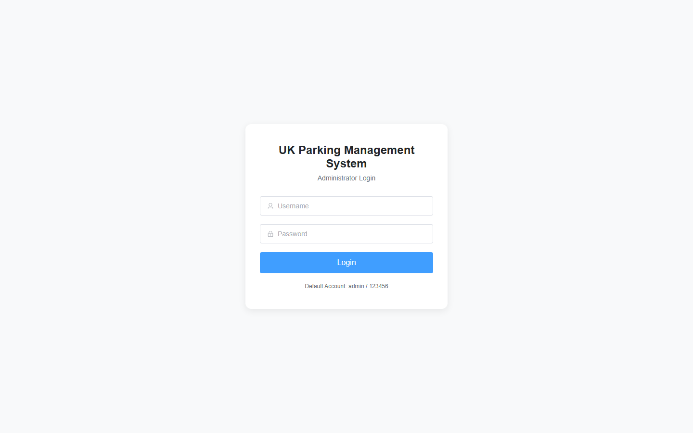
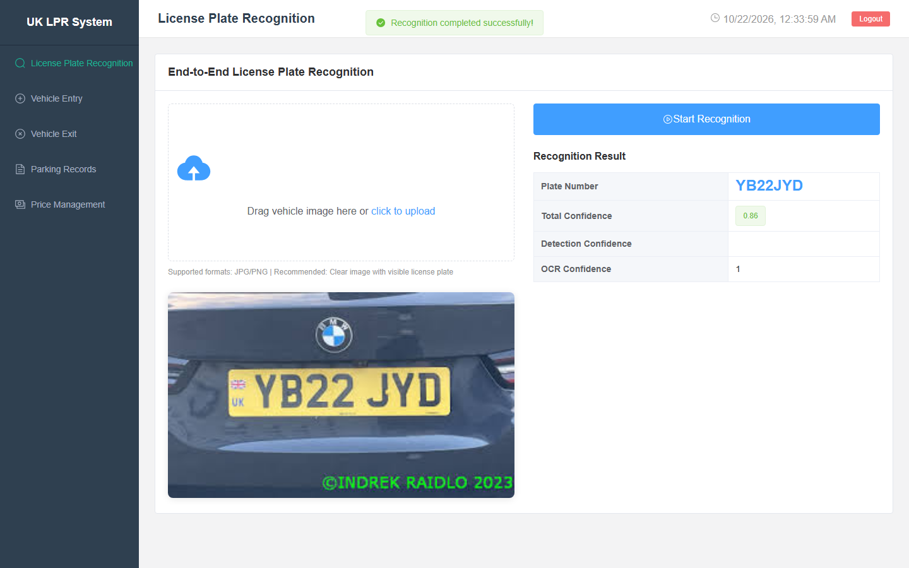
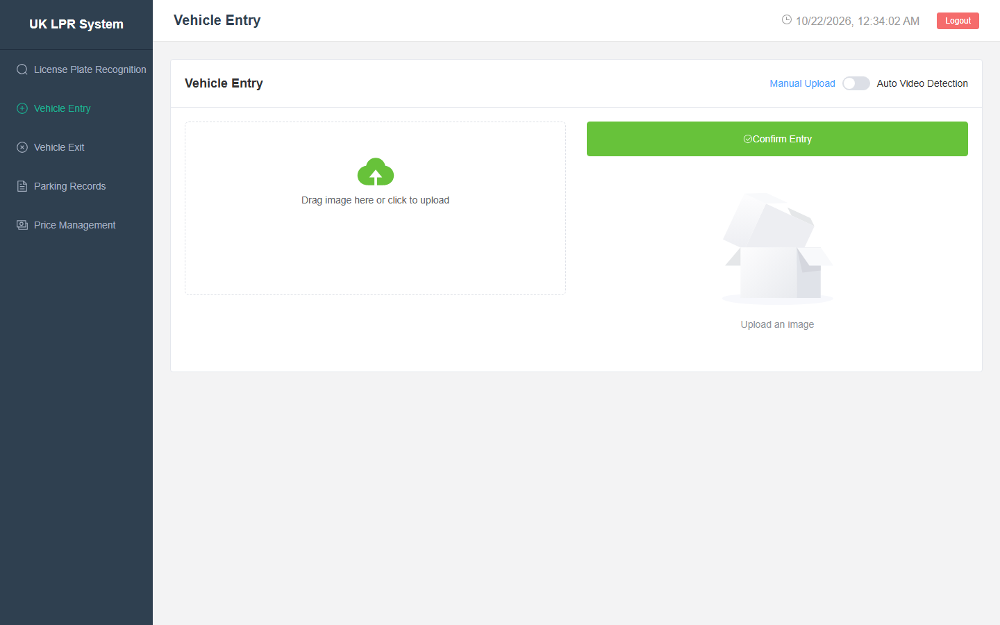
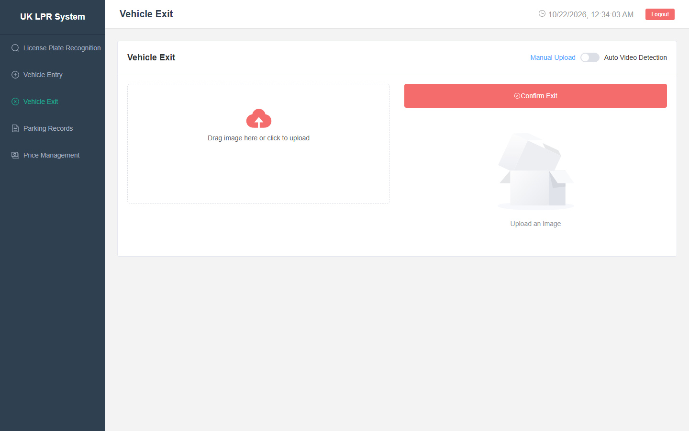
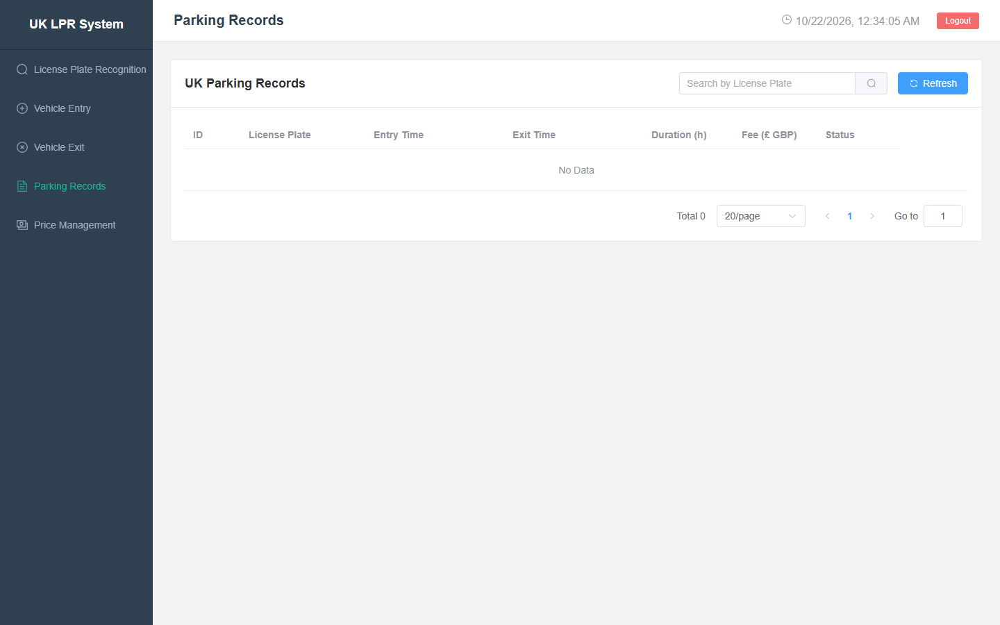
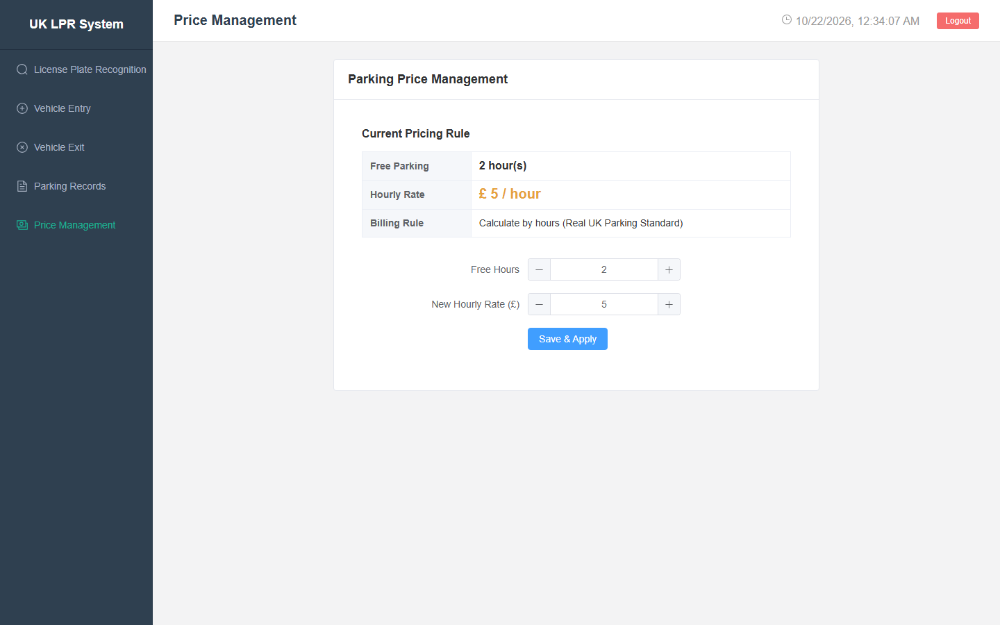

# 🚗 车牌识别智能停车系统
# License Plate Recognition Smart Parking System

<div align="center">

**一个基于深度学习的端到端车牌识别（ALPR）智能停车管理系统**

*An end-to-end Automatic License Plate Recognition (ALPR) smart parking management system powered by deep learning.*

[](backend/requirements.txt)
[](backend/requirements.txt)
[](frontend/package.json)
[](frontend/package.json)
[](frontend/package.json)
[](backend/weights/best.pt)

</div>

---

## 📖 项目简介 / Overview

本项目是一套**车牌识别智能停车管理系统**，通过 **YOLOv8 目标检测 + OCR** 实现车辆车牌的自动定位与识别，并提供完整的停车业务流程：车辆入场登记、出场计费、历史记录查询、费率管理等功能。

*This project is a **license-plate-recognition smart parking system**. It combines **YOLOv8 object detection with OCR** to automatically locate and recognise vehicle license plates, and provides a complete parking workflow: vehicle entry registration, exit billing, historical record query and rate management.*

核心识别流程 / *Core ALPR pipeline*：

```
图像输入 Input → 增强 Enhancement (CLAHE) → 检测 Detection (YOLOv8)
   → 透视校正 Perspective Correction → 识别 OCR (fast-plate-ocr) → 入库 & 展示
```

---

## ✨ 功能特性 / Features

| 功能 Feature | 说明 Description |
| --- | --- |
| 🔐 管理员登录 | 基于 JWT 的身份认证，后端密码哈希存储 |
| 📸 车辆入场 | 上传车辆图片，自动检测并识别车牌，登记入场时间 |
| 🚗 车辆出场 | 上传出场图片，匹配车牌并自动计算停车时长与费用 |
| 🧮 计费规则 | 前 2 小时免费，之后 5.0 / 小时（可在后台配置） |
| 📋 记录查询 | 历史停车记录支持搜索、筛选与导出 |
| ⚙️ 费率管理 | 后台动态调整小时费率 |
| 🧪 识别测试 | 独立识别页面，直接测试 ALPR 流水线而不产生停车记录 |

---

## 🖼️ 界面预览 / Screenshots

### 登录 / Login


### 车牌识别 / License Plate Recognition


### 车辆入场 / Vehicle Entry


### 车辆出场 / Vehicle Exit


### 停车记录 / Parking Records


### 费率管理 / Price Management


---

## 🛠️ 技术栈 / Tech Stack

**后端 / Backend**

| 技术 | 用途 |
| --- | --- |
| [FastAPI](https://fastapi.tiangolo.com/) | REST API 框架 |
| [SQLAlchemy](https://www.sqlalchemy.org/) | ORM + SQLite |
| [Ultralytics YOLOv8](https://github.com/ultralytics/ultralytics) | 车牌检测 |
| [fast-plate-ocr](https://github.com/ankandrew/fast-plate-ocr) | 车牌 OCR |
| [OpenCV](https://opencv.org/) | 图像增强 / 透视校正 |
| [python-jose](https://github.com/mpdavis/python-jose) + [passlib](https://passlib.readthedocs.io/) | JWT 与密码哈希 |

**前端 / Frontend**

| 技术 | 用途 |
| --- | --- |
| [Vue 3](https://vuejs.org/) | UI 框架 |
| [Vite](https://vitejs.dev/) | 构建工具 / 开发服务器 |
| [Element Plus](https://element-plus.org/) | UI 组件库 |
| [Pinia](https://pinia.vuejs.org/) + [Vue Router](https://router.vuejs.org/) | 状态管理与路由 |
| [Axios](https://axios-http.com/) | HTTP 客户端 |

---

## 🚀 快速开始 / Getting Started

### 环境要求 / Requirements

- **Python** 3.10 / 3.11（不支持 3.12+）
- **Node.js** 18+（本项目使用 Vite 5）
- 端口 `8000`（后端）与 `3001`（前端）未被占用

### 1. 后端 / Backend

```bash
cd backend
pip install -r requirements.txt
uvicorn app.main:app --host 0.0.0.0 --port 8000 --reload
```

> 首次启动会加载 YOLOv8 与 OCR 模型，约需 20–30 秒，属正常现象。
> SQLite 数据库 `parking.db` 会在首次运行时自动创建。

### 2. 前端 / Frontend

```bash
cd frontend
npm install
npm run dev
```

### 3. 访问 / Access

| 入口 | 地址 |
| --- | --- |
| 前端主界面 | http://localhost:3001 |
| 后端 API 文档 (Swagger) | http://localhost:8000/docs |

**默认账号 / Default account**：`admin` / `123456`

---

## 🗂️ 项目结构 / Project Structure

```
backend/
  app/
    algorithm/          # ALPR 流水线：增强 → 检测 → 校正 → OCR
    api/v1/endpoints/   # auth / parking / recognition / records / pricing
    core/               # 配置、数据库、安全
    models/             # SQLAlchemy 模型
    schemas/            # Pydantic 校验
    services/           # 业务逻辑（停车 / 记录）
    utils/              # 日志、图像工具
  weights/best.pt       # YOLOv8 训练权重（22MB）
frontend/
  src/
    views/              # 登录、布局、识别、入场/出场、记录、费率
    components/         # 可复用组件（图片上传等）
    api/                # Axios 封装
    router/             # 带鉴权守卫的路由
test_images/            # 示例车辆图片
docs/screenshots/       # 界面截图
```

---

## 👤 作者 / Author

**Li Wenhao** · [University of Aberdeen](https://www.abdn.ac.uk/)

> 📫 联系方式 / Contact：`email@example.com` · [GitHub](https://github.com/yourname) · [LinkedIn](https://linkedin.com/in/yourname)

---

## 📄 许可 / License

本项目仅供学习与求职展示使用。*This project is for learning and portfolio demonstration purposes.*
